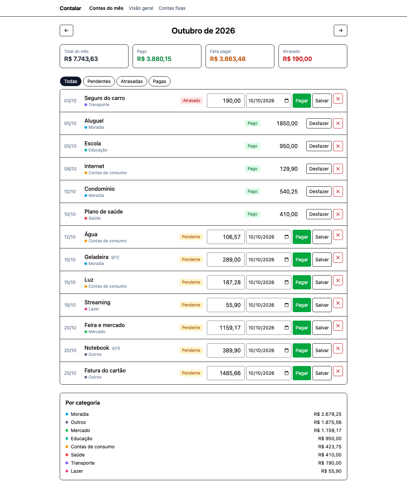
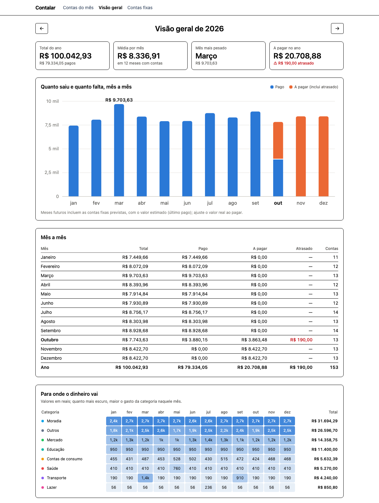
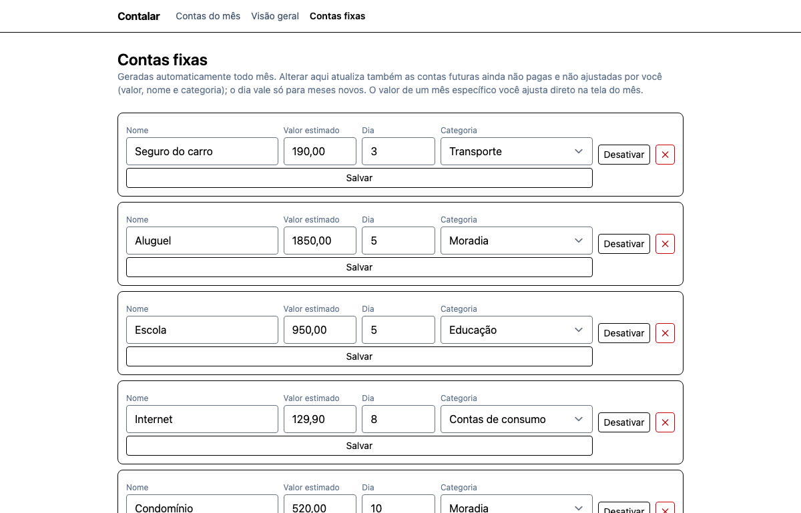

# Contalar

**English** · [Português](README.pt-BR.md) · [Español](README.es.md) · [日本語](README.ja.md)

> Household bills, without the spreadsheet. Runs on your own computer: no account, no cloud, no subscription.

Contalar (_contas_ + _lar_, Portuguese for "household bills") is a small web app to track what your household has to pay each month and what is already paid. It replaces the monthly spreadsheet: recurring bills appear on their own, you type the real amount, press **Enter**, and it is marked as paid.



## Features

- **Month view**: every bill of the month with its status (paid, pending, overdue), summary cards, a status filter and totals by category. Type the real amount and press **Enter** to pay.
- **Recurring bills**: rent, electricity, internet… are created automatically every month with an estimated amount (the last one you paid). You only fix the amount when the bill arrives.
- **Installments**: a purchase in N payments creates N monthly bills (`3/10`).
- **Overview**: a yearly dashboard with paid vs. to-pay per month, a forecast until December and a category × month heatmap.
- **Local and private**: your data stays in a SQLite file on your machine. The server only listens on `localhost` and the app makes no external requests.
- **Backups**: a daily copy of the database, optionally pushed to a private git repository.



## How it works

The app is organised around three screens (the interface is currently in Brazilian Portuguese, see [Limitations](#limitations); the terms below map them):

| Screen          | In the app      | What it is for                                                         |
| --------------- | --------------- | ---------------------------------------------------------------------- |
| Month view      | _Contas do mês_ | Pay bills, add one-off or installment bills, see the month at a glance |
| Overview        | _Visão geral_   | The big picture of the year                                            |
| Recurring bills | _Contas fixas_  | Define the bills that repeat every month                               |

### A typical month

1. **Once:** register your recurring bills (_Contas fixas_): name, estimated amount, due day and category.
2. **Open the month.** Each recurring bill shows up with its estimated amount. Opening the same month again never duplicates anything.
3. **When a bill arrives or is paid:** type the real amount and press **Enter** (or click _Pagar_ = Pay). The payment date defaults to today and can be changed. _Salvar_ (Save) stores only the amount without marking it paid.
4. **One-off or installment purchases:** use _Nova conta_ (New bill). Set "parcelas" (installments) above 1 and one bill per month is created, labelled `n/N`.
5. **Look at the overview** to see where the money goes and how the next months look.



### Details worth knowing

- **Status** is derived: _Pago_ (paid) if it has a payment date; _Atrasado_ (overdue) if it is unpaid and the due date has passed; otherwise _Pendente_ (pending).
- **Deleting a bill that came from a recurring bill** only removes that month; the recurring bill keeps working in the others. Deleting the recurring bill itself keeps the bills already generated.
- **Editing a recurring bill** also updates its future, unpaid bills (amount, name, category), except those whose amount you already adjusted by hand. The due day only applies to new months.
- **Forecast:** opening the Overview of the current year creates the recurring bills for the remaining months, with estimated amounts, so you can see the year ahead.
- Amounts are stored as integer **cents** (no floating-point rounding errors) and dates as `YYYY-MM-DD`.

### Terms used in the interface

| Portuguese                 | English                  |
| -------------------------- | ------------------------ |
| Contas do mês              | Month view               |
| Visão geral                | Overview                 |
| Contas fixas               | Recurring bills          |
| Nova conta                 | New bill                 |
| Pagar / Salvar / Desfazer  | Pay / Save / Undo        |
| Pago / Pendente / Atrasado | Paid / Pending / Overdue |
| Total do mês / Falta pagar | Month total / Remaining  |
| Por categoria              | By category              |

## Quick start

Requirements: **Node.js 22.17 or newer**, plus `bash`, `curl` and `lsof` (macOS or Linux; on Windows use WSL).

```sh
git clone https://github.com/wilsonbrito/contalar.git
cd contalar
./iniciar.sh
```

The script installs dependencies, creates the database, builds the app, starts it at <http://localhost:3000> and opens your browser. Stop it with `Ctrl+C`. Use `PORT=4000 ./iniciar.sh` for another port.

### Try it with demo data

Want to look around before entering your own bills? Load a fictional family:

```sh
npm install
npm run demo        # creates demo.db with a made-up household
npm run demo:dev    # opens the app on top of demo.db
```

`demo.db` is separate from your real database (`local.db`), and the demo script refuses to touch `local.db`.

## Backups

Every time the app starts it makes a consistent copy of the database in `backups/` (`local-YYYY-MM-DD.db`, one per day, the 30 most recent are kept). To restore, stop the app and copy a backup over `local.db`.

For an off-machine copy, make `backups/` its own **private** git repository with a remote. `iniciar.sh` then runs `scripts/enviar-backup.sh` after startup, which commits and pushes new backups (and retries if a previous push failed):

```sh
cd backups
git init -b main && git add -A && git commit -m "first backup"
gh repo create my-contalar-backups --private --source=. --push   # or any private remote
```

> **Keep that repository private**: the database contains all your finances. Set `SEM_ENVIO_BACKUP=1` to disable the automatic push.

## Privacy

- Data lives in `local.db` and `backups/`, both git-ignored.
- The server binds to `127.0.0.1`; nothing is reachable from your network.
- No accounts, no telemetry, no external requests (no CDN, no fonts, no analytics).

## Limitations

- **The interface is in Brazilian Portuguese** and currency is shown as BRL (`R$`). Translating it and supporting other currencies is the most welcome contribution, see below.
- Built for **one household on one computer**: there is no login or multi-user support.
- Only bills to pay are tracked, not income, budgets or investments.
- Tested on macOS; Linux should work; Windows is untested (use WSL).

## Development

```sh
npm install
cp .env.example .env     # DATABASE_URL=local.db
npm run db:push          # create/update tables
npm run dev              # http://localhost:5173
npm run check            # type check
npm test                 # unit tests (dates, installments, summaries, backups)
```

| Path                    | What                                               |
| ----------------------- | -------------------------------------------------- |
| `src/lib/financeiro.ts` | Pure logic: dates, status, installments, summaries |
| `src/lib/server/db/`    | Schema (Drizzle), queries, backup                  |
| `src/routes/`           | Screens: `/` (month), `/fixas`, `/visao-geral`     |
| `scripts/`              | `demo.ts` (fictional data), `enviar-backup.sh`     |
| `iniciar.sh`            | One-command launcher                               |

**Stack:** SvelteKit 3 · TypeScript · Tailwind CSS 4 · Drizzle ORM + better-sqlite3 · Vitest.

Contributions are welcome, especially translations of the interface. Open an issue to discuss before large changes.

## License

[MIT](LICENSE) © Wilson Brito
